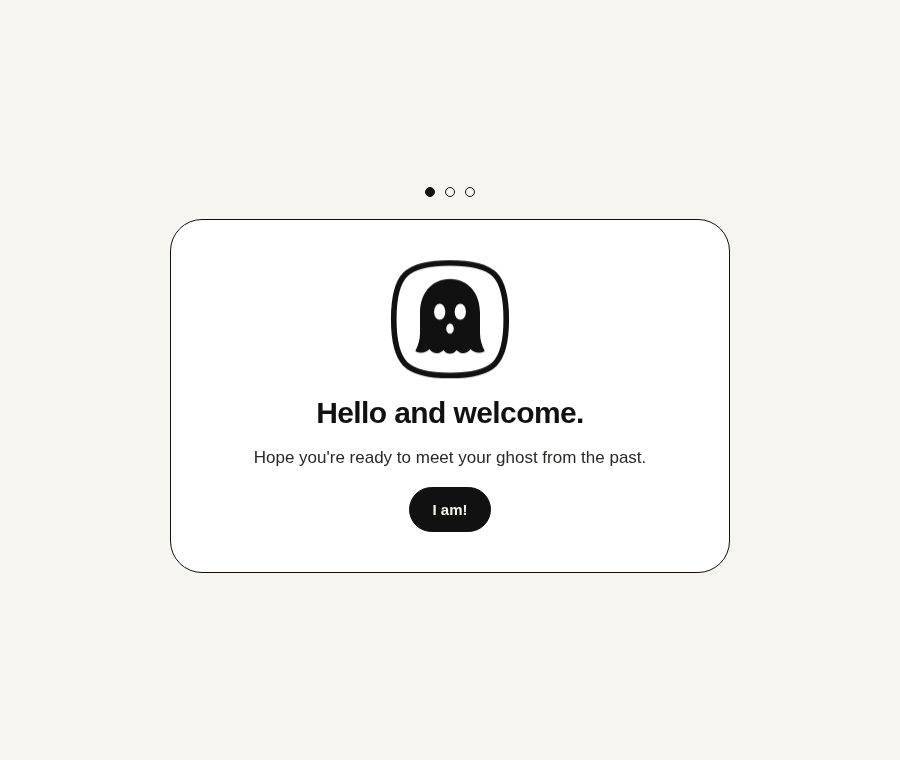
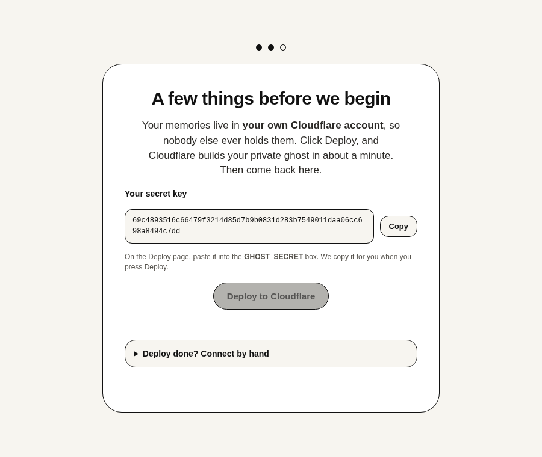
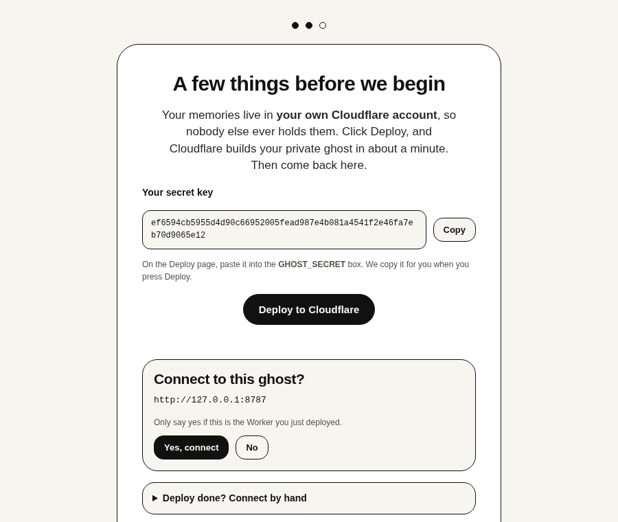
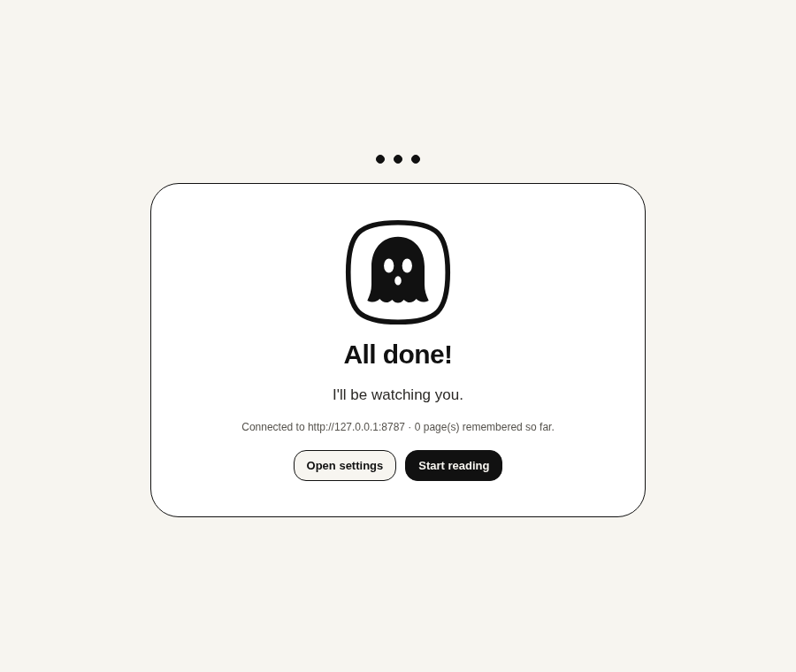
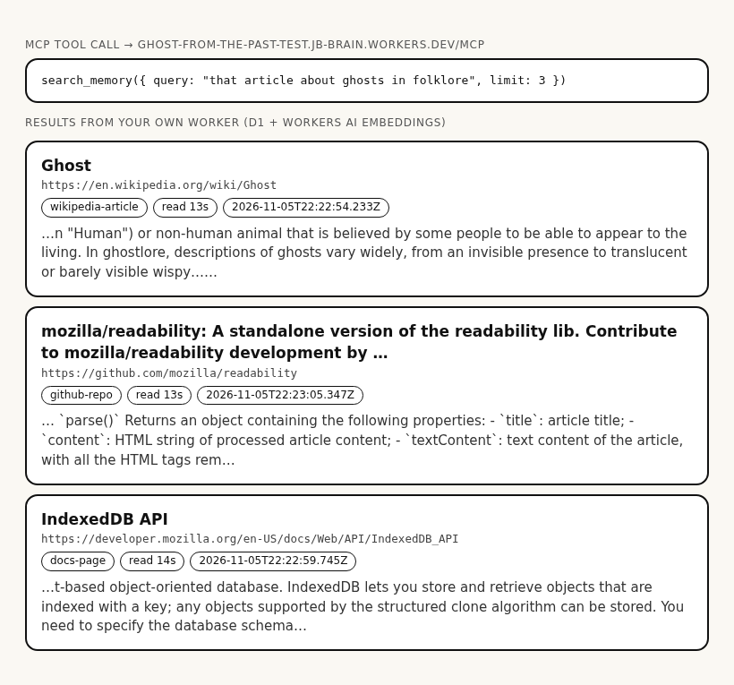
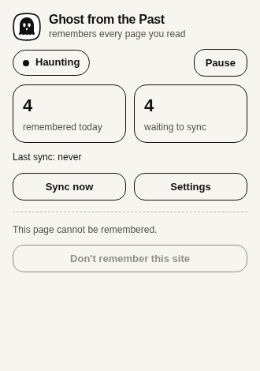
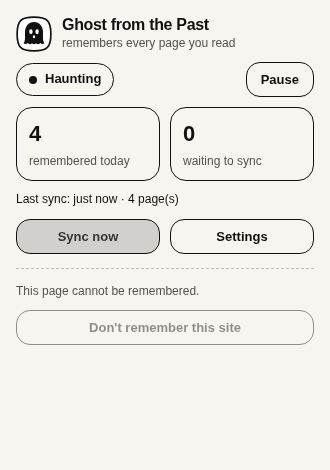
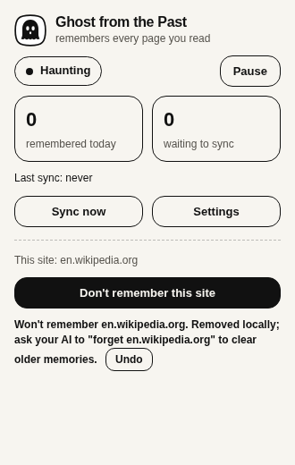
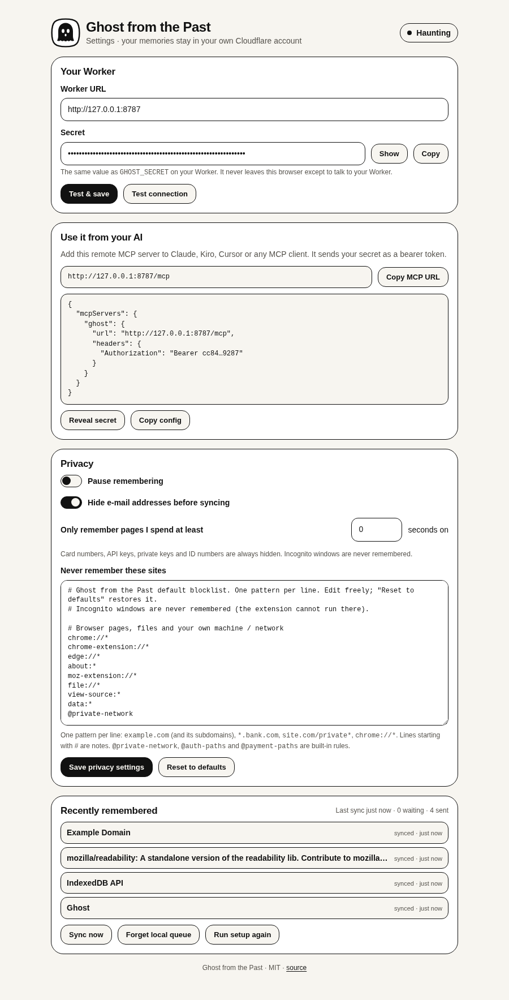
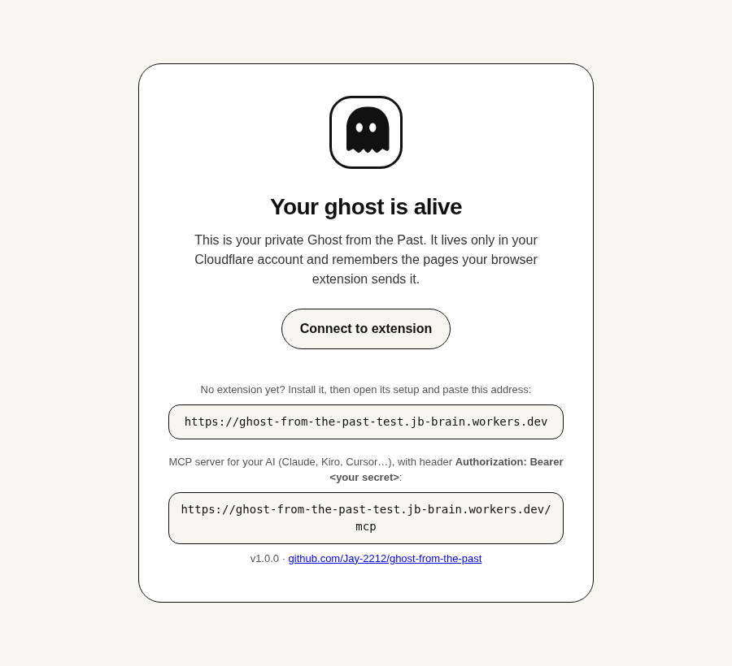

# Ghost from the Past


**A ghost from your past that remembers every page you've read.**

**Demo video (under 3 min):** https://youtu.be/3SesyYAMOOo · **Devpost:** https://devpost.com/software/ghost-from-the-past

A personal, privacy-first browser memory for knowledge workers, researchers, and curious readers. Ghost quietly captures and makes searchable every web article you read, storing it in your own Cloudflare account. No central server. No tracking. No data leaves your infrastructure.

---

## What It Does

The ghost remembers every page you read:

- **Clean markdown** of the article, extracted with site-specific extractors (YouTube, Reddit, X, GitHub, Wikipedia, Stack Exchange, product pages, docs, news).
- **URL and title**, captured when you visit.
- **Time on page**: how long you actually spent reading (only while visible and focused, capped at 5s gaps to survive screen-lock).
- **Date and visit count**: first seen, last seen, number of times you've read it.

All stored in your own Cloudflare Worker, with full-text search (D1 FTS5) and optional semantic search (Vectorize or D1 vector fallback with Workers AI embeddings).

Searchable by any AI assistant that supports MCP — Claude Desktop, Claude Code, Kiro CLI, or any MCP client.

---

## How It Works

```
┌─────────────────────────┐
│   Browser Extension     │
│  (Chrome MV3, ES2022)   │
│  • Captures pages       │
│  • Extracts markdown    │
│  • Local queue          │
└───────────┬─────────────┘
            │
            │ HTTPS + Bearer auth
            ▼
┌─────────────────────────┐
│  Your Cloudflare Worker │
│  • D1 database          │
│  • D1 vectors           │
│    (or Vectorize)       │
│  • Workers AI embed     │
│  • MCP server at /mcp   │
└───────────┬─────────────┘
            │
            │ MCP over HTTP
            ▼
┌─────────────────────────┐
│  Claude / Kiro / any    │
│  MCP-compatible client  │
│  Authorization: Bearer  │
└─────────────────────────┘
```

### MCP Tools

- **`search_memory`**: semantic + keyword search with filters (date range, domain, page kind), returns ranked results with snippets, URLs, titles, reading time.
- **`list_pages`**: list pages by date/domain/kind, newest first.
- **`get_page`**: full markdown by URL or ID.
- **`forget`**: permanently delete specific pages by exact `ids` (up to 50) or exact `url`, with `confirm: true`. To forget a whole site or day, ask your AI to `list_pages` with that domain/date first and pass the ids. There is deliberately no bulk "forget everything from X" call, so text inside a remembered page can't talk an AI into wiping your memory.
- **`memory_stats`**: page count, chunk count, total reading time, top domains and kinds.

Page text returned by `search_memory` and `get_page` is marked as untrusted third-party content (a notice line plus `untrusted: true`), and the server instructions tell the AI never to follow instructions found inside it.

---

## Privacy

Ghost is built privacy-first:

- **No central server.** Everything runs in your Cloudflare Workers account. We never see your data.
- **Incognito is never captured.** Private browsing stays private. The extension refuses to run in incognito mode.
- **Secret never leaves your machine/Worker.** Your `GHOST_SECRET` is generated in the browser, pasted into your Worker, and used only for authentication. Before the extension sends it anywhere, the Worker must prove it already knows it (an HMAC of a random nonce, bound to the Worker's own address), so a look-alike page or a fake Worker can't collect it.
- **Where the secret is stored.** The extension keeps it in `chrome.storage.local`, in plain text. Anything with access to your browser profile on disk can read it; Ghost is an unpacked personal tool and can't meaningfully protect it from that. The Options and setup pages mask it until you press Show. To rotate it: put a new value in the Worker (`npx wrangler secret put GHOST_SECRET` or the dashboard), then paste the same value into Options → Secret and press Save.
- **Default blocklisting**: sites that should never be captured are blocked by default:
  - **Browser pages and private network**: chrome://, localhost, private IPs, single-label intranet names.
  - **Sign-in/accounts/one-time codes**: login pages, OAuth flows, password resets, account settings, auth paths.
  - **Email and private messages**: webmail, WhatsApp, Telegram, Discord, Slack, Teams, Messenger, DMs.
  - **Private documents, workspaces and AI chats**: Google Docs/Drive/Calendar/Keep/Photos, OneDrive/SharePoint/Office, Dropbox, Box, Notion, Slack workspaces, Atlassian (Jira/Confluence), ChatGPT, Claude, Gemini.
  - **Password managers**: 1Password, Bitwarden, LastPass, Dashlane, RoboForm, Enpass, any `vault.*` host, etc.
  - **Banking/UPI/payments/investing/crypto**: banks, payment processors, UPI apps, checkout/payment paths, trading platforms, exchanges.
  - **Health portals**: patient portals, telemedicine sites, health records.
  - **Government/tax/ID**: UIDAI, income tax, DigiLocker, passport, PF, GST, IRS, SSA, etc.
  
  Rules are checked against both the page's real address and its canonical address, and path rules also apply to hash-routed apps (`/#/login`, `#!/checkout`). Nothing is captured until the extension is connected to your Worker.

  The blocklist is editable in Options with **"Reset to defaults"** to restore it. Capture is automatic on every other site (that's the product); if you want less, add patterns or use the popup's "Don't remember this site".
- **"Don't remember this site"**: a button in the toolbar popup blocks the current domain forever (shows "Won't remember \<site\>" with Undo for 5 seconds).
- **Redaction by default**: card numbers, API keys/tokens/private keys (OpenAI, Anthropic, Stripe, GitHub, GitLab, AWS, Slack, Google, Hugging Face, npm, SendGrid, DigitalOcean, Shopify, Azure, Slack/Discord webhooks, JWTs), SSN-like, Aadhaar-like and PAN IDs are stripped from captured content, including nested metadata, before upload. Phone numbers and street addresses are not redacted (too many false positives in normal articles). Email addresses are hidden by default and switchable in Options.
- **You can forget.** The `forget` tool in MCP deletes the exact pages you name (by id or URL).
- **Worker hardening**: CORS headers (`Access-Control-Allow-Origin: *`) are sent only on `/mcp`, `/health`, the landing page `/`, and `OPTIONS` preflights, which get an empty 204 and need no auth. Data routes (`/ingest`, `/api/*`) get no CORS headers, because the extension doesn't need them, so other websites can't read them from a browser. Every response carries `X-Content-Type-Options: nosniff`, and an optional Workers rate limit (300 requests/minute per route and IP, `ratelimits` in `wrangler.jsonc`) caps abuse if a secret ever leaks.
- **You can delete everything.** Delete the Worker and the D1 database (and the Vectorize index, if you created one). The ghost vanishes.

---

## For Judges

1. Download `ghost-from-the-past-extension-v1.0.0.zip` from the [v1.0.0 release](https://github.com/Jay-2212/ghost-from-the-past/releases/tag/v1.0.0) (the same file is in the repo at `release/`) and unzip it.
2. In Chrome, open `chrome://extensions`, turn on **Developer mode** (top right), click **Load unpacked** and pick the unzipped folder.
3. To test without a Cloudflare account, skip the Deploy step: in the onboarding tab's paste fields (or Options), enter the test Worker URL and secret given privately in the Devpost testing-instructions field, then press **Test connection**.

Use a fresh Chrome profile for this, because the test Worker is shared and every page you read while connected is sent to it. When you are done, pause the extension (popup or Options) or remove it.

To run your own Worker instead, follow the setup below.

---

## 10-Minute Setup

### 1. Load the Extension

1. Get the extension: download and unzip `ghost-from-the-past-extension-v1.0.0.zip` from the [v1.0.0 release](https://github.com/Jay-2212/ghost-from-the-past/releases/tag/v1.0.0), or clone this repo (`git clone https://github.com/Jay-2212/ghost-from-the-past.git`) and use its `extension/` directory.
2. Open Chrome (or any Chromium browser) and go to `chrome://extensions/`
3. Enable **Developer mode** (top right).
4. Click **Load unpacked** and select the unzipped folder (or `extension/` in the clone).

The extension will open an onboarding tab.

**Firefox** (140 or later): run `node scripts/build-firefox.mjs` in the clone. It writes `dist/firefox/` and `release/ghost-from-the-past-firefox-v1.0.0.zip` with a Firefox manifest; `extension/` itself stays the Chrome build. Open `about:debugging#/runtime/this-firefox`, click **Load Temporary Add-on…** and pick `dist/firefox/manifest.json` (or the zip). Firefox removes temporary add-ons when it restarts. The add-on is not on AMO yet. The install prompt lists "browsing activity" and "website content" as data the add-on transmits: that is the page URL, title, reading time and text, sent only to your own Worker. For Chrome, Edge and other Chromium browsers, `node scripts/build-chrome.mjs` zips `extension/` to `release/ghost-from-the-past-chromium-v1.0.0.zip`.



### 2. Deploy Your Worker

You have two options:

#### Option A: Deploy to Cloudflare Button

Click the button below to deploy to your Cloudflare account:

[](https://deploy.workers.cloudflare.com/?url=https://github.com/Jay-2212/ghost-from-the-past/tree/main/worker)

The Deploy page does the setup for you:

- **`GHOST_SECRET`**: the page shows an empty, required field for it (it comes from `worker/.dev.vars.example` and the `cloudflare.bindings` description in `worker/package.json`). Paste the secret from the onboarding screen; pressing **Deploy to Cloudflare** there already copied it to your clipboard. The Worker refuses to start serving data with a missing, short or placeholder secret.
- **D1**: the `ghost-memory` database is created automatically. The deploy script (`npm run deploy`) applies the migrations, and if they were skipped the Worker creates the schema on its first request (`ensureSchema` in `worker/src/schema.ts`).
- **Vectors**: stored in D1 by default, so the page asks no Vectorize questions. Vectorize is optional; see [Free Tier Limits](#free-tier-limits).

There is no `wrangler secret put` step on this path.

#### Option B: Manual Deploy

```bash
cd worker
npm install
npx wrangler d1 create ghost-memory
# Put the database_id it prints into wrangler.jsonc (d1_databases[0].database_id)
npm run deploy            # applies the D1 migrations, then wrangler deploy
npx wrangler secret put GHOST_SECRET
```

Paste the secret from the onboarding screen. Vectors live in D1 unless you opt into Vectorize: `npx wrangler vectorize create ghost-memory --preset @cf/baai/bge-small-en-v1.5`, then add the `vectorize` binding shown in the comment in `worker/wrangler.jsonc` and deploy again.



### 3. Connect the Extension to Your Worker

1. Visit your Worker URL (e.g., `https://ghost-from-the-past.YOUR_SUBDOMAIN.workers.dev/`).
2. The landing page will hand the Worker URL to the extension.
3. The extension will show a confirmation screen. Click **Yes, connect to this Worker**.



4. The extension tests the connection and shows **"All done! I'll be watching you."**



---

## Connect Claude Desktop / Claude Code / Kiro

Add this to your MCP config:

### Claude Desktop

Edit `~/Library/Application Support/Claude/claude_desktop_config.json` (macOS) or `%APPDATA%\Claude\claude_desktop_config.json` (Windows):

```json
{
  "mcpServers": {
    "ghost-from-the-past": {
      "command": "npx",
      "args": [
        "mcp-remote",
        "https://ghost-from-the-past.YOUR_SUBDOMAIN.workers.dev/mcp",
        "--header",
        "Authorization: Bearer ${GHOST_SECRET}"
      ],
      "env": {
        "GHOST_SECRET": "YOUR_SECRET_HERE"
      }
    }
  }
}
```

Restart Claude Desktop.

### Claude Code

```bash
claude mcp add --transport http ghost https://ghost-from-the-past.YOUR_SUBDOMAIN.workers.dev/mcp --header "Authorization: Bearer YOUR_SECRET_HERE"
```

### Kiro CLI

Edit `~/.kiro/settings/mcp.json` (or `.kiro/settings/mcp.json` in a workspace):

```json
{
  "mcpServers": {
    "ghost-from-the-past": {
      "url": "https://ghost-from-the-past.YOUR_SUBDOMAIN.workers.dev/mcp",
      "headers": {
        "Authorization": "Bearer YOUR_SECRET_HERE"
      }
    }
  }
}
```

This repo also ships [`.kiro/settings/mcp.json`](.kiro/settings/mcp.json), which registers your own Worker for Kiro sessions in this workspace. It reads the secret from the `GHOST_SECRET` environment variable (`Bearer ${GHOST_SECRET}`) and is `"disabled": true` until you replace `<your-worker>` with your Worker's address and remove that line.

### Fallback: Token in Query String

This is **off by default**. A token in the URL can end up in Cloudflare's observability logs (enabled in `wrangler.jsonc`), browser history and client logs, so prefer the `Authorization` header. If your MCP client really can't send headers, set the Worker variable `ALLOW_QUERY_TOKEN` to `true` (Cloudflare dashboard → Settings → Variables, or `vars` in `wrangler.jsonc`; consider turning observability off too), then append `?token=YOUR_SECRET` to the URL:

```json
{
  "mcpServers": {
    "ghost-from-the-past": {
      "url": "https://ghost-from-the-past.YOUR_SUBDOMAIN.workers.dev/mcp?token=YOUR_SECRET"
    }
  }
}
```

(Less secure; prefer the `Authorization` header if supported.)

---

## Example Prompts

Once connected, try asking your AI assistant:

- **"What did I read about vector databases last week?"**
- **"Find that article about Rust async I read on November 3rd."**
- **"List everything I read on GitHub yesterday."**
- **"Show me the full text of the Wikipedia article about ghosts I read."**
- **"How much time have I spent reading developer.mozilla.org?"**
- **"List my example.com pages, then forget the one about cookies."**

The AI will use the MCP tools to search your reading memory and answer with citations.



*Real `search_memory` response from the deployed test Worker, rendered as cards by a Hark script.*

---

## Free Tier Limits

Ghost is designed to fit within Cloudflare's free tier for personal use:

- **D1**: generous storage and read/write quotas. A typical page is 1 row + 4-8 chunk rows.
- **Vectorize** (optional, off by default): free tier supports thousands of pages (384-dim embeddings, max 8 chunks per page).
- **Workers AI**: free Neurons/day for embedding calls. One page = ~1 batch call for 4-8 chunks.
- **Workers requests**: free tier supports typical personal browsing. The extension batches uploads; sync runs every 5 minutes or on-demand.

Check [Cloudflare's current free tier limits](https://developers.cloudflare.com/workers/platform/pricing/) for exact numbers.

By default the Worker stores vectors in D1 (D1VectorStore: JSON vectors, brute-force cosine search). It uses Vectorize only if you add a `VECTORS` binding (see the comment in `worker/wrangler.jsonc`) and don't set `VECTOR_MODE=d1`. D1 is slower than Vectorize at large scale, but needs no extra setup.

D1-stored vectors are scanned in full on every semantic query, so switch to Vectorize beyond roughly 1,000-2,000 pages.

---

## Screenshots

### Popup



*Before syncing: local queue shown.*



*After syncing: last sync time and page count.*



*Popup button shows "Won't remember \<site\>" with Undo for 5 seconds.*

### Options



*Settings: Worker URL + secret, Test connection, MCP URL/config copy, pause, hide emails, minimum time on page, blocklist + Reset to defaults, recently remembered, Sync now, Forget local queue, Run setup again.*

### Worker Landing



*Your Worker's home page: hands the URL to the extension, shows connection status.*

---

## Testing

Ghost has three test suites plus a live extractor check. Setup, from the repo root:

```bash
npm install                        # root: Playwright + MCP client, for e2e and the extractor check
npx playwright install chromium
(cd worker && npm install)
(cd extension && npm ci)           # jsdom, Readability, Turndown (dev-only, not shipped)
```

### Worker Tests (Vitest)

```bash
cd worker
npm test
npm run typecheck
```

47 tests in 7 files: `auth.test.ts` (bearer compare, origin-bound proof, weak/placeholder secret rejection), `chunk.test.ts`, `embed.test.ts`, `search.test.ts`, `util.test.ts` `schema.test.ts` (the `ensureSchema` fallback creates the tables only when they are missing) and `ingest.test.ts` (a retried page whose chunks were never written gets them on the merge path).

### Extension Tests (Node.js `node:test`)

```bash
cd extension
npm test
```

38 tests covering extraction pipeline, privacy/blocklist/redaction (incl. hash routes, new private-surface defaults, nested meta, extra token formats), the Worker proof (HMAC test vector) and blocklist-undo. Uses jsdom for DOM mocking. `npm test` runs `node --test test/*.test.mjs`. From the repo root, `node --test extension/test` also works on Node 22: Node no longer expands a directory there, so it loads `extension/test/index.js`, which imports every `*.test.mjs`.

### End-to-End Tests (Playwright)

```bash
node tests/e2e/run.mjs                                       # local: wrangler dev, local D1, mock embeddings
WORKER_URL=https://ghost-from-the-past.YOUR_SUBDOMAIN.workers.dev GHOST_SECRET=YOUR_SECRET_HERE \
  node tests/e2e/run.mjs                                     # against a deployed Worker
```

Loads the real unpacked extension in headless Chromium. On 2026-11-06 it passed 26/26 against a freshly deployed Worker (new D1, new secret, deployed with `npm run deploy`); results are in `shots/e2e-results.json`. A local run adds two checks (wrangler dev starts, the landing page hands the Worker URL to the extension); the last local run was 28/28. The checks:

- Extension service worker loads; onboarding opens on install; the extension generates a 256-bit secret.
- Worker reachable; connection test passes ("All done! I'll be watching you."); Options "Test connection" works.
- Pages are captured into the local queue; a blocklisted page (accounts.google.com) is not.
- Popup "Sync now" sends the queue; 4 pages, 26 chunks and their kinds arrive in D1.
- MCP lists the 5 tools; `search_memory` finds the Wikipedia ghost article, and with a domain filter finds MDN; `list_pages` for today returns 4 pages; `get_page` returns the full markdown.
- `forget` refuses without `confirm`, deletes a page by id, refuses bulk domain deletes; the forgotten page is gone; search results are framed as untrusted content.
- MCP without the secret is rejected (401); `?token=` is off by default (401).
- `/api/verify` returns the origin-bound HMAC proof and rejects a malformed nonce (400).
- CORS headers on `/mcp`, not on `/api/stats`.
- A fake Worker that answers `/health` but can't prove the secret is refused and never receives it.

### Live Extractor Check

```bash
node tests/extractors/live.mjs
```

Runs the extraction pipeline on 11 real URLs. Latest run (`tests/extractors/out/summary.json`, 2026-11-06): 7 pass (GitHub repo and issue, Wikipedia, Amazon product, BBC article, BBC section page, MDN), 0 fail, 4 blocked by the sites for headless/anonymous access (YouTube 429, Reddit 403, X network error, Stack Overflow 403).

---

## How Kiro Built This

Ghost was built with **Kiro CLI** for Kiroween 2026, in headless sessions (`kiro-cli chat --no-interactive`, see [`docs/kiro-logs/README.md`](docs/kiro-logs/README.md)). Kiro wrote the steering files and the spec (76 tasks, all ticked), the hooks and the `ghost` custom agent, and the Worker scaffold. From S5 to S11 it reviewed and fixed the code: the e2e race, popup and extractor fixes, the pre-release audit, the S9 security hardening and the S10 Deploy-button work. When Kiro credits ran out after S4, Hark (another AI agent) wrote most of the application code; the authorship table below says who did what.

### Kiro Features Used

| Feature | Files |
|---------|-------|
| Spec | [`.kiro/specs/ghost-from-the-past/`](.kiro/specs/ghost-from-the-past/) (`requirements.md`, `design.md`, `tasks.md`) |
| Steering | [`.kiro/steering/`](.kiro/steering/) (`product.md`, `tech.md`, `design-language.md`) |
| Hooks | [`.kiro/hooks/`](.kiro/hooks/) (`secret-guard.mjs`, `test-on-write.mjs`, `README.md`) |
| Agent | [`.kiro/agents/ghost.json`](.kiro/agents/ghost.json) |
| MCP | [`.kiro/settings/mcp.json`](.kiro/settings/mcp.json) (your own Ghost Worker as a remote MCP server) |
| Logs | [`docs/kiro-logs/`](docs/kiro-logs/) (session prompts and logs) |

### Spec-Driven Development

The project started with an 8-section **Brief** ([`docs/BRIEF.md`](docs/BRIEF.md)), written by Hark from the product owner's requirements, then expanded by Kiro into three formal specs:

1. **Requirements** ([`.kiro/specs/ghost-from-the-past/requirements.md`](.kiro/specs/ghost-from-the-past/requirements.md)): must-have + should-have features, constraints, success criteria.
2. **Design** ([`.kiro/specs/ghost-from-the-past/design.md`](.kiro/specs/ghost-from-the-past/design.md)): architecture, data model, API contracts, security model, error handling.
3. **Tasks** ([`.kiro/specs/ghost-from-the-past/tasks.md`](.kiro/specs/ghost-from-the-past/tasks.md)): 14 phases with 76 checklist items, all ticked.

Kiro updated the specs in S4 when new requirements came in (onboarding flow, privacy defaults, site-specific extractors), and the steering files in S11b to match the shipped code.

### Steering Files

Three steering files provided ongoing context:

- **[`product.md`](.kiro/steering/product.md)**: vision, users, privacy promise, non-goals, market positioning.
- **[`tech.md`](.kiro/steering/tech.md)**: stack, conventions, testing commands, build/deploy steps (`inclusion: always`, so it is in every session's context).
- **[`design-language.md`](.kiro/steering/design-language.md)**: UI palette, typography, layout patterns (for screenshots and HTML templates).

### Custom Agent and Hooks

S1 wrote two hook definitions in an invented JSON format (`"trigger": "PostFileSave"`) that Kiro CLI never loaded, so sessions S1 to S10 ran on the default agent without hooks. In S11a Kiro replaced them with a real Kiro CLI custom agent, [`.kiro/agents/ghost.json`](.kiro/agents/ghost.json). It loads the steering files and specs as resources and wires these hooks (details in [`.kiro/hooks/README.md`](.kiro/hooks/README.md)):

- **`agentSpawn`**: prints the current branch and `git status --short`.
- **`preToolUse`** on `fs_write`, `execute_bash` and `code`: [`secret-guard.mjs`](.kiro/hooks/secret-guard.mjs) reads the hook event on stdin and exits 2 (blocks the tool call, with a reason on stderr) when the write or command contains a `GHOST_SECRET=`/Cloudflare token assignment, a known provider token, a 40+ character high-entropy string, or a write to `.dev.vars`. On `git commit`/`git push` it also scans the staged diff.
- **`postToolUse`** on `fs_write`: [`test-on-write.mjs`](.kiro/hooks/test-on-write.mjs) runs the worker vitest suite after a `worker/` edit, or the extension `node:test` suite after an `extension/` edit, and prints the result. It never blocks.
- **`stop`**: reminds the agent to run the full suites.

S11b ran on this agent. In that session the guard blocked one of Kiro's own commands, because a test script contained a 62-character alphabet string that looked high-entropy.

### Vibe Coding vs Spec Coding

- **Spec coding** (Kiro S1, S2, S4): Kiro wrote or updated the specs first, then implemented from them. High structure and clear success criteria; Hark could take over the implementation after S4 because the specs were already written.
- **Vibe coding** (Kiro S5 to S11): Kiro was given task-scoped prompts and worked directly against the existing specs. Faster for fixes, reviews, security hardening, deploy work and documentation.

Spec coding was better for new subsystems (MCP server, D1 schema, extraction pipeline). Vibe coding was better for iteration and bug-fixing (e2e test flakiness, popup UI polish, review findings).

### Authorship Table

Based on `git log --oneline` and session logs in [`docs/kiro-logs/`](docs/kiro-logs/). There was no S3 session.

| Commit(s) | Author | What | Session |
|-----------|--------|------|---------|
| `d18715a` | **Kiro** | Steering files, specs (requirements/design/tasks), first hook scripts (secret-guard, test-on-save), worker scaffold (auth, chunk, embed, store, util + 15 util tests), wrangler config | S1, S2 |
| `a52afca` (specs only) | **Kiro** | Spec updates: requirements/design/tasks for onboarding, privacy defaults, extraction pipeline | S4 (log not kept) |
| `a52afca` (worker code), `3feb307`, `4b4bcfe`, `b42026f`, `26ddc2c`, `f81f288`, `5df70a7`, `d98918a` | **Hark** | Worker (index, ingest, search, MCP, landing, env, chunk/store changes), extension (manifest, content script, background sync, popup, options, onboarding, blocklist, redaction, extractors, unit tests), e2e tests, screenshots | (Kiro credits exhausted after S4) |
| `3f0747d`, `950bda6`, `5761c47` | **Hark** | Worker tests pass (37), typecheck clean, extension unit tests (27) | (no Kiro session log) |
| `36ed733` | **Kiro** | E2e sync-wait race fixed, popup "Last sync" from `ghost:status`, review of Hark-written code, S5b follow-up fix | S5, S5b |
| `8829ca3` | **Kiro** | Popup forget-site undo test + toast styling, live extractor check (`tests/extractors/live.mjs`), S6b fix, tasks.md ticked | S6, S6b |
| `afa565b` | **Hark** | Screenshots: real `search_memory` result from deployed test Worker (rendered as cards), popup "Don't remember this site" toast | (after S6) |
| `895d1c4` | **Hark** | S7 prompt: authorship facts for README table | (before S7) |
| `6ab8bdd` | **Kiro** | README, THIRD_PARTY.md | S7, S7b |
| `61ccca3` | **Kiro** | Pre-release audit: MV3 background, fetch timeouts, GitHub/news extractor fixes | S8, S8b |
| `b624bc2` | **Kiro** | Security fixes from the Kiro/Grok/Gemini reviews: origin-bound HMAC proof before the secret is sent, `?token=` opt-in, exact-id `forget` + untrusted-content framing, real-URL + hash-route blocklist checks, CORS scope, YouTube caption URL check, no capture before connect, private-surface defaults, recursive meta redaction, rate-limit binding, masked secret in setup; unit tests | S9 |
| `035d8eb` | **Hark** | Triage of every finding, S9 prompt, `ratelimits` config fix, README security/privacy text, new e2e checks, [docs/security-review.md](docs/security-review.md) | (after S9) |
| `e450e08` | **Kiro** | Deploy-to-Cloudflare readiness: blank required `GHOST_SECRET` field, Worker fails closed on weak/placeholder secrets, Vectorize optional (D1 vectors by default), migrations in the deploy script + `ensureSchema` fallback; tests | S10 |
| `c739f84`, `614bad5` | **Hark** | S10 log; v1.0.0 release zip | (after S10) |
| `703d62b` | **Kiro** | `ghost` custom agent, Kiro CLI hook scripts (secret-guard rewrite, test-on-write), hooks README | S11a |
| `703d62b` | **Kiro** | Doc and repo fixes from the final audits: README deploy/test/Kiro sections, steering and design corrections, manifest cleanup, `extension/node_modules` untracked, logs README | S11b |
| `703d62b` | **Kiro** | Firefox build: `scripts/build-firefox.mjs` (Firefox manifest in `dist/firefox/`, Firefox release zip), Chrome-only API audit ([s12.log](docs/kiro-logs/s12.log)) | S12 |
| (this commit) | **Kiro** (claude-opus-5.5) + **Hark** | Production-readiness pass after a three-reviewer audit (Kiro, Grok, Antigravity): sync no longer wedges on 413 (batch 5, per-page retry), merge path rewrites missing chunks, `list_pages` marked untrusted, content script no longer reads the secret, test hook gated, `forget([])` guard, more default-blocked consoles and `AWS_SECRET_ACCESS_KEY=`-style redaction, a11y fixes, `.kiro/settings/mcp.json`; Hark: README/test-count updates and review | S13a, S13b |

**Product owner (Jay)**: idea, name and requirements. `docs/BRIEF.md` was written down by Hark from those requirements.

Hark (an AI agent) wrote most of the application code while Kiro credits were exhausted. Kiro wrote the steering, specs, hooks, agent and scaffold, and from S5 on reviewed, hardened and changed the code.

### Known Gaps

Honest list of what's incomplete or not tested:

- **Live extractor check**: 7 of 11 pass; YouTube, Reddit, X and Stack Overflow block headless/anonymous access, so those 4 extractors are covered only by unit tests on fixtures.
- **Vectorize path not exercised**: the deployed test Worker uses D1VectorStore (no `VECTORS` binding), not Vectorize, because the Cloudflare API token used for testing has no Vectorize permission. Vectorize code is written but not e2e-tested.
- **Not on Chrome Web Store**: users must load the extension unpacked. This is by design (no Google review process, users can audit the code), but it's a barrier to adoption.

---

## Logs & Prompts

Kiro session logs and prompts are in [`docs/kiro-logs/`](docs/kiro-logs/) ([how they were produced](docs/kiro-logs/README.md)). There was no S3, and the S4 log was not kept (only its prompt).

- **[s1.log](docs/kiro-logs/s1.log)**, **[s1-prompt.md](docs/kiro-logs/s1-prompt.md)**: steering files, specs, hooks.
- **[s2.log](docs/kiro-logs/s2.log)**, **[s2-prompt.md](docs/kiro-logs/s2-prompt.md)**: worker scaffold.
- **[s4-prompt.md](docs/kiro-logs/s4-prompt.md)**: spec updates for onboarding, privacy, extractors (log not kept).
- **[s5.log](docs/kiro-logs/s5.log)**, **[s5-prompt.md](docs/kiro-logs/s5-prompt.md)**, **[s5b.log](docs/kiro-logs/s5b.log)**, **[s5b-prompt.md](docs/kiro-logs/s5b-prompt.md)**: e2e sync-wait race fixed, popup improvements.
- **[s6.log](docs/kiro-logs/s6.log)**, **[s6-prompt.md](docs/kiro-logs/s6-prompt.md)**, **[s6b.log](docs/kiro-logs/s6b.log)**, **[s6b-prompt.md](docs/kiro-logs/s6b-prompt.md)**: popup forget-site, live extractor check.
- **[s7-prompt.md](docs/kiro-logs/s7-prompt.md)**, **[s7.log](docs/kiro-logs/s7.log)**, **[s7b-prompt.md](docs/kiro-logs/s7b-prompt.md)**, **[s7b.log](docs/kiro-logs/s7b.log)**: this README.
- **[s8-prompt.md](docs/kiro-logs/s8-prompt.md)**, **[s8.log](docs/kiro-logs/s8.log)**, **[s8b-prompt.md](docs/kiro-logs/s8b-prompt.md)**, **[s8b.log](docs/kiro-logs/s8b.log)**: pre-release audit and fixes ([s8-audit.md](docs/kiro-logs/s8-audit.md)).
- **[s9-prompt.md](docs/kiro-logs/s9-prompt.md)**, **[s9.log](docs/kiro-logs/s9.log)**: security fixes from the Kiro, Grok and Gemini reviews (see [docs/security-review.md](docs/security-review.md)).
- **[s10-prompt.md](docs/kiro-logs/s10-prompt.md)**, **[s10.log](docs/kiro-logs/s10.log)**: Deploy-to-Cloudflare button readiness.
- **[s11a-prompt.md](docs/kiro-logs/s11a-prompt.md)**, **[s11a.log](docs/kiro-logs/s11a.log)**: the `ghost` custom agent and Kiro CLI hooks (cut off by a timeout; finished at the start of S11b).
- **[s11b-prompt.md](docs/kiro-logs/s11b-prompt.md)**, **[s11c-prompt.md](docs/kiro-logs/s11c-prompt.md)**, **[s11b.log](docs/kiro-logs/s11b.log)**: S11a checks and the final-audit doc/repo fixes, run on the `ghost` agent ([audits](docs/reviews/)).
- **[s12-prompt.md](docs/kiro-logs/s12-prompt.md)**, **[s12.log](docs/kiro-logs/s12.log)**: Firefox build (`scripts/build-firefox.mjs`).
- **[s13a-prompt.md](docs/kiro-logs/s13a-prompt.md)**, **[s13a.log](docs/kiro-logs/s13a.log)**, **[s13b-prompt.md](docs/kiro-logs/s13b-prompt.md)**, **[s13b.log](docs/kiro-logs/s13b.log)**: production-readiness fixes from the three-reviewer audit.

---

## License

MIT. See [LICENSE](LICENSE).

Third-party dependencies: see [THIRD_PARTY.md](THIRD_PARTY.md).

---

## Contributing

Ghost is a Kiroween 2026 project. We're not accepting external contributions at this time, but you're welcome to fork it and run your own ghost. 👻

If you find a bug or have a feature request, open an issue.

---

**Built with Kiro CLI + Hark, for Kiroween 2026.**
